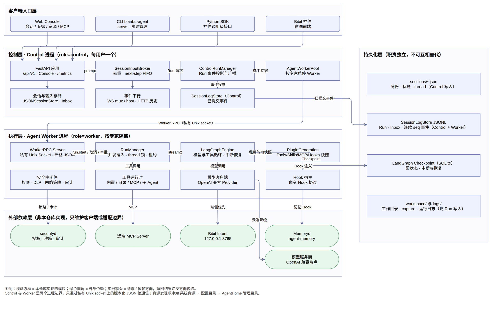
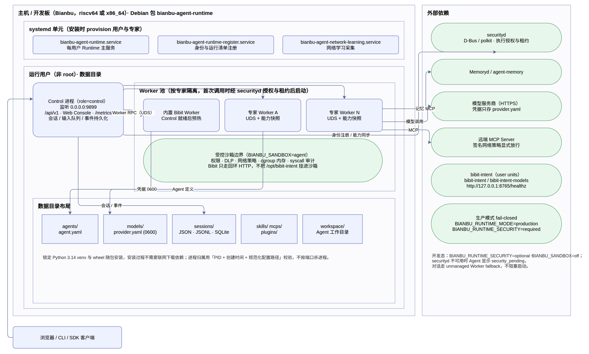
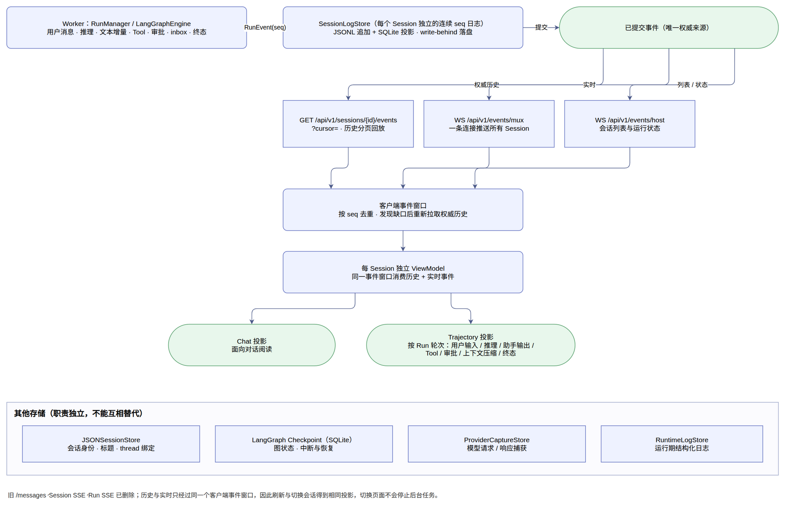
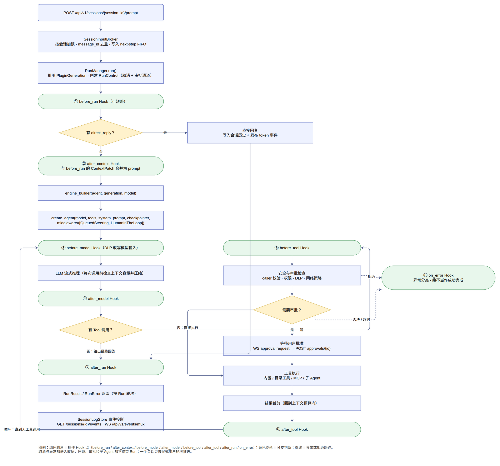

# Bianbu Agent Runtime 概要设计

> 基线：`e26f4b27`（debian/changelog `0.1.132`，`pyproject.toml` 记 `0.1.131`）
> 语言/运行时：Python 3.14（`requires-python = ">=3.14,<3.15"`）
> 交付形态：单包单命令，`bianbu-agent` CLI 同时承担控制面服务与本地资源管理

本文档面向开发、联调和集成方，描述仓库当前实现的**总体结构、模块划分、关键设计决策、核心流程与接口边界**。
它不替代细节文档，各主题的权威说明见文末「参考文档」。

---

## 1. 范围与定位

`bianbu-agent-runtime` 是一个**由 YAML 配置驱动的个人 Agent 服务**：把会话、模型、工具、
插件、Skill、MCP、安全和记忆统一封装成可本地部署的进程，对外提供 HTTP / WebSocket 接口、
Web 控制台和 CLI，向内通过插件宿主承载扩展能力。

仓库本身的实现边界：

- **在本仓库内实现**：Runtime 组合根、FastAPI 控制面、Web 控制台静态资源、CLI、SDK 契约、
  插件宿主与贡献模型、工具运行时、会话/Run/事件存储、模型客户端、安全中间件、Worker 进程管理。
- **在本仓库外实现，只维护客户端或适配边界**：`securityd`、`Memoryd`/`agent-memory`、
  `bibit-intent`、远端模型服务、远端 MCP Server、`searxng`、`spacemit-ai-gateway`、
  `llama.cpp-tools-spacemit`、`agent-browser`。

## 2. 设计目标

| 目标 | 落地方式 |
| --- | --- |
| 显式配置边界 | 服务与资源管理使用 `--config`；项目开发命令按项目 `runtime.yaml` → `BIANBU_AGENT_CONFIG` → 命令级 `--config` 的顺序解析 |
| 引擎可替换 | `AgentEngine` 是抽象契约，LangGraph 只是默认实现，`engine_builder` 可注入；插件契约里不出现 LangGraph |
| 代际隔离 | 每次执行租用不可变的 `PluginGeneration`，能力重载只影响之后的 Run |
| 单事件源 | 会话历史以「持久事件日志 + 客户端折叠」为唯一来源，历史回放与实时推送共用同一投影 |
| 无外部数据库 | Agent/Session/Run/Checkpoint 全部文件化（JSON/JSONL/SQLite），开箱即用 |
| 端侧优先 | 模型调用优先本地/端侧（Bibit、SpacemiT 推理），不可用时按云端降级 |
| 国产平台适配 | 针对 riscv64 提供免编译 wheel 源与依赖锁定 |
| 安全默认收敛 | 能力校验、文件支撑校验、审批、DLP、沙箱、网络策略、审计均为默认开启项 |

## 3. 总体架构

### 3.1 分层视图

```text
┌───────────────────────────────────────────────────────────────┐
│ 客户端入口                                                     │
│  Web Console (/、/chat)  ·  CLI (bianbu-agent)  ·  Python SDK  │
│  Bibit 插件（意图前端）                                        │
└───────────────────────────┬───────────────────────────────────┘
                            │ HTTP / WebSocket（/api/v1、/metrics）
┌───────────────────────────┴───────────────────────────────────┐
│ Control 进程（role = control）                                 │
│  FastAPI 应用 · SessionInputBroker · SessionTitleManager       │
│  BianbuAgentRuntime 组合根 · AgentWorkerPool · 事件下行         │
│  会话存储 / 输入队列 / Run 事件持久化                           │
└───────────────────────────┬───────────────────────────────────┘
                            │ 版本化 Worker RPC（私有 Unix socket，JSON 帧）
┌───────────────────────────┴───────────────────────────────────┐
│ Worker 进程（role = worker，按专家管理）                        │
│  WorkerRPC · RunManager · AgentEngine/LangGraphEngine          │
│  PluginGeneration · 内置/目录工具 · MCP 客户端 · 模型客户端      │
│  安全中间件（执行前/后校验）                                    │
└───────────────────────────┬───────────────────────────────────┘
                            │
┌───────────────────────────┴───────────────────────────────────┐
│ 持久化                                                         │
│  会话 JSON · SessionLogStore(JSONL) · LangGraph Checkpoint     │
│  provider-capture · observability 运行日志                      │
└───────────────────────────────────────────────────────────────┘
```



> 矢量图 [01-overview.svg](refs/01-overview.svg) · 可编辑源图 [01-overview.drawio](refs/01-overview.drawio)

### 3.2 进程模型

- **Control**：常驻，唯一对外监听 `service.host:service.port`（开发默认 `0.0.0.0:9899`）。
  持有会话身份、输入队列、Run 事件持久化与全部管理 API。内置 Bibit 预热在此阶段完成。
- **Worker**：按专家隔离，通过私有 Unix socket 接收执行请求；承载模型、工具、插件和
  LangGraph Checkpoint。首次调用时经 securityd 授权与租约后启动；开发态 securityd 不可用时
  走 unmanaged Worker fallback，Agent 显示 `security_pending`，对话不阻塞。
- **两者共用同一个 `BianbuAgentRuntime` 组合根**，用 `role` 参数裁剪能力，避免维护两套装配逻辑。



> 矢量图 [03-deployment.svg](refs/03-deployment.svg) · 可编辑源图 [03-deployment.drawio](refs/03-deployment.drawio)

### 3.3 依赖边界

```
Runtime ── securityd            （能力授权、沙箱、DLP、审计、syscall 策略、cgroup 限额）
        ── Memoryd/agent-memory （长期记忆，通过 bianbu.memory 插件对接）
        ── bibit-intent         （端侧意图/模型，稳定 HTTP 127.0.0.1:8765）
        ── 模型服务商            （OpenAI 兼容端点，凭据存 models/<provider>/provider.yaml）
        ── 远端 MCP Server      （mcp 客户端，仅放行签名网络策略声明的地址）
        ── searxng / ai-gateway （搜索与网关，Debian 依赖提供）
```

## 4. 模块分解

`bianbu_agent/`（约 260 个 Python 文件、5.6 万行）按职责划分：

| 包 | 职责 | 关键类型 |
| --- | --- | --- |
| `server/` | 组合根、FastAPI 装配、进程归属与生命周期 | `BianbuAgentRuntime`、`create_app`、`RuntimeProcessOwner` |
| `api/` | `/api/v1` 资源化路由 | sessions / agents / models / packages / mcp_servers / capabilities / executions / runtime_status / security / monitoring / events |
| `runs/` | Run 生命周期、事件、取消与恢复 | `RunManager`、`RunControl`、`RunControlRegistry`、`RunEvent`、`RunResult`、`RunError` |
| `engines/` | 执行引擎契约与默认实现 | `AgentEngine`（Protocol）、`LangGraphEngine`、`build_langgraph_agent`、`AgentExecutorRouter` |
| `sessions/` | 会话身份、输入队列、事件日志、搜索 | `SessionManager`、`SessionInputBroker`、`SessionInboxProjection`、`SessionLogStore`、`JSONSessionStore` |
| `plugins/` | 插件发现、清单校验、代际租约与宿主 | `PluginManager`、`PluginHost`、`PluginGeneration`、`PluginContributions`、`HookPoint` |
| `tools/` | 内置工具、目录工具加载、运行时绑定 | `builtins.py`、`loader.py`、`runtime.py`、`processes/terminal.py` |
| `security/` | 安全中间件、沙箱、DLP、syscall 审计、Worker 进程监督 | `security_middleware.py`、`security_sandbox.py`、`WorkerSupervisor`、`WorkerRPCClient`、`ExecutionCoordinator` |
| `mcp/` | MCP Server 配置、凭证、安装、就绪检查、客户端 | `client.py`、`manager.py`、`install.py`、`readiness.py` |
| `models/` | 服务商与模型记录、上下文容量目录 | `YAMLModelStore`、`ModelRegistry`、`context_profiles.py` |
| `agents/` | 逻辑 Agent 的持久化、包导入与选择 | `AgentManager`、`ManifestAgentStore`、`AgentPackageManager`、`presets.py` |
| `context/` | 上下文检查、压缩与工具结果裁剪 | `compression.py`、`middleware.py`、`model_catalog.py`、`tool_results.py` |
| `hooks/` | 命令 Hook 的加载与执行 | `command.py`、`loader.py`、`models.py` |
| `skills/` | Skill 包管理与版本 | `SkillPackageManager`、`versions.py` |
| `capture/` + `observability/` | 模型请求捕获与运行日志 | `ProviderCaptureStore`、`RuntimeLogStore` |
| `cli/` | 命令行入口与解析 | `main.py`、`parser.py`、`output.py` |
| `console/web/` | Web 控制台模板与静态资源 | `chat.html`、`static/`、`vendor.py` |
| `_internal/` | 原子写、文件锁、记录存储等基础设施 | `locking.py`、`json_records.py`、`yaml_documents.py` |

## 5. 关键设计决策

**5.1 组合根单例**

`BianbuAgentRuntime` 是唯一的装配点，持有全部 manager（Skills/Plugins/MCP/Packages/Models/
Agents/Sessions/Runs/Execution）。对外只暴露 `start()` / `close()` / 诊断信息，避免各层自行
构造依赖。

**5.2 引擎按 Agent 定义缓存**

`AgentFactory` 的缓存键由 Agent 的身份、`soul`、模型、tools、skills、mcps、hooks、plugins
共同决定；任一字段变化即换新 engine 并淘汰旧实例。运行时**拒绝 per-Run 模型覆盖**，模型只能
来自 Agent 自己的 `agent.yaml`，保证「一次 Run 的能力来源可解释」。

**5.3 代际租约（Generation Lease）**

插件与能力集合被冻结为不可变 `PluginGeneration`。内部执行开始时租用一次，整个 Run 使用同一份
快照；重载只影响之后的执行，运行中的 Run 不会被换掉能力。这是「热更新不打断执行」的核心机制。

**5.4 事件日志 + 客户端折叠**

一次会话的全部内容（用户消息、推理、文本增量、Tool、审批、Session inbox、Run 终态）写入该
Session 独立的连续 `seq` 日志。历史回放（`GET /sessions/{id}/events`）与实时推送
（`WS /api/v1/events/mux`）走同一份已提交事件；客户端按 `seq` 去重，发现缺口后重新拉取权威
历史。控制台为每个 Session 维护独立 ViewModel，同一事件窗口分别投影成 Chat 与 Trajectory，
**不维护第二份轨迹存储**。旧的 `/messages`、Session SSE、Run SSE 已删除。



> 矢量图 [04-events.svg](refs/04-events.svg) · 可编辑源图 [04-events.drawio](refs/04-events.drawio)

**5.5 输入统一为 next-step FIFO**

所有聊天输入（包括新对话第一条）都提交到 `POST /api/v1/sessions/{session_id}/prompt`，进入
Session 的持久 `next-step` FIFO。活动执行在当前模型或工具步骤结束的安全边界批量领取并在同一
thread 继续；空闲 Session 或错过终止窗口时由服务端内部启动执行接手。请求不带 `mode`，
Runtime 不提供 Queue 模式，也不对外暴露 Run 资源。

**5.6 一个会话只按显式用户轮次推进**

不提供长期目标、目标工具与自动续跑；每次推进都由用户的显式输入触发。

**5.7 资源发现三优先级**

`系统资源 → 配置目录 → AgentHome 管理目录`。同名资源按此顺序解析，管理目录用于安装/覆盖，
系统资源用于出厂内置。

**5.8 校验时点前移**

`RuntimeDiagnostics` 在启动时校验能力声明；`require_file_backed_capabilities` 拒绝「幽灵注册」
（声明了能力但没有真实文件支撑），`allow_unmanaged_capabilities=false` 禁止未托管能力。

## 6. 核心流程

### 6.1 启动

```
CLI serve
  └─ 解析配置（--config / BIANBU_AGENT_CONFIG / 默认 config/development.yaml）
      └─ create_runtime()  → BianbuAgentRuntime（role=control）
          ├─ AgentHome(data_dir).prepare()：建立 agents/models/sessions/skills/mcps/plugins/workspace/logs
          ├─ 资源发现与清单校验（系统 → 配置 → 管理目录）
          ├─ 装载内置插件与预设 Expert（resources/default-profile）
          ├─ SecurityRuntimeClient 绑定身份（可失败 → security_pending）
          ├─ 内置 Bibit 预热（探测 127.0.0.1:8765/healthz，未就绪不阻塞）
          └─ create_app(runtime) → FastAPI（/api/v1 + Console + /metrics）
              └─ 启动 uvicorn 监听 service.host:service.port
```

Worker 在专家首次被调用时按需启动：Control 侧 `WorkerSupervisor` 向 securityd 申请租约 →
拉起 Worker 进程 → `hello` 握手 → `worker.catalog` 取回能力目录。生产模式下
`BIANBU_RUNTIME_SECURITY=required` 为 fail-closed。

### 6.2 单次 Run 执行循环

图内 8 个 Hook 点由插件贡献，执行顺序为：

```
POST /api/v1/sessions/{session_id}/prompt
  └─ SessionInputBroker：message_id 去重 → 写入 next-step FIFO
      └─ RunManager.run()
          ├─ 租用 PluginGeneration（不可变能力快照）
          ├─ 创建 RunControl（取消信号 + 审批通道）
          └─ _execute()
              ├─ ① before_run      （可返回 direct_reply 短路整个 LLM 循环）
              ├─ ② after_context   （与 before_run 的 ContextPatch 合并成 prompt）
              ├─ engine_builder(agent, generation, model)
              │     └─ LangGraphEngine.stream()
              │         ├─ create_agent(model, tools, system_prompt, checkpointer,
              │         │                middleware=[QueuedSteering, HumanInTheLoop])
              │         └─ 循环（每次模型调用前先做上下文容量检查与压缩）：
              │              ③ before_model → LLM 流式推理 → ④ after_model
              │              ⑤ before_tool → 工具执行 → ⑥ after_tool
              │              重复直到得到最终回答
              ├─ ⑦ after_run
              └─ ⑧ on_error（异常分类，绝不当作成功）
          └─ RunResult / RunError 落库 → 事件投影 → 下行
```



> 矢量图 [02-run-flow.svg](refs/02-run-flow.svg) · 可编辑源图 [02-run-flow.drawio](refs/02-run-flow.drawio)

`before_run` / `after_context` 通过 `ContextPatch` 注入上下文并写入会话历史，前者还可直接给出回复
而跳过模型调用；`before_model` 在每次模型调用前触发，也是 DLP 改写模型输入的位置（`after_context`
的 DLP 只扫用户输入）。

### 6.3 工具执行与安全边界

工具元数据声明 `requires_approval=true` 时，每次执行前等待用户批准。除此之外 Runtime 会动态
检查 `terminal` 的命令参数：只要检测到独立的 `rm` 命令词（含脚本、heredoc、包装器、子 Shell）
就强制触发审批，批准前不执行终端工具。

四类工具实现统一走同一条执行链：**内置工具 → 目录工具 → MCP 工具 → 子 Agent**，每条都先过
安全与审批检查，再执行 `before_tool`/`after_tool` Hook，结果裁剪后回到模型循环。

### 6.4 上下文压缩

每次模型调用前按当前模型容量检查上下文。摘要有独立期限：超时使用本地摘要，普通失败保留历史，
取消继续传播。压缩完成后仍在原 Run 继续执行，不重启、不结束 Run。

### 6.5 取消与后台进程

- 取消走 `POST /api/v1/sessions/{session_id}/cancel`，通过 `RunControl` 传播，异常路径进入
  `on_error` 分类收尾。
- 后台进程有独立的 `session_id` 与生命周期；前台默认等待 180 秒，超时或取消走 SIGKILL 与
  取消传播。
- 会话删除会等待被取消的 Run 流退出（超时 30 秒），保证 Run 投影不会被已删除的流继续写入。

### 6.6 会话状态与前端语义

会话列表返回 `running`、`waiting`、`failed`、`completed_unread`、`active_run_id` 和
`pending_interaction`。页面切换不会停止后台任务，未选中会话完成后仍会提醒；浏览器不连接单个
Run，也不在切换会话时重连。

## 7. 数据与持久化设计

数据根由 `data_dir` 决定（开发默认 `../.bianbu-agent`）：

```
<data_dir>/
├── agents/<agent-id>/agent.yaml        逻辑 Agent 定义（soul、model、tools、skills、mcps、hooks、plugins）
├── models/<provider>/provider.yaml     服务商连接信息与凭据（0600）
├── sessions/                           会话身份、Run/inbox/事件日志、搜索索引
├── skills/  mcps/  plugins/            扩展根，由对应 manager 按需创建
├── workspace/                          Agent 工作目录（Console 提供 HTML 报告下载入口）
└── logs/                               provider-capture/ 与 operational/runtime.jsonl
```

各存储职责不可互相替代：

| 存储 | 内容 | 实现 |
| --- | --- | --- |
| `JSONSessionStore` | 会话身份、标题、thread 绑定 | JSON |
| `SessionLogStore` | Run、Inbox、连续 `seq` 事件日志（读写投影 + write-behind） | JSONL + SQLite |
| LangGraph Checkpoint | 图状态、中断与恢复 | SQLite（`langgraph-checkpoint-sqlite`） |
| `ProviderCaptureStore` | 模型请求/响应原始捕获（可配置开关与目标） | JSONL + 索引 |
| `RuntimeLogStore` | 运行期结构化日志 | JSONL |

Memory 插件与外部 `agent-memory` 服务是**上述存储的补充**，不是替代物。

## 8. 扩展机制

### 8.1 插件（Plugin）

插件是宿主进程内的**可信 Python 代码**，不是操作系统沙箱。`plugin.yaml` 契约 v1 描述包布局、
版本与宿主契约、`config_schema`、entrypoint 和命名空间。贡献通过**扫描目录**发现而非清单声明，
支持：Hook、Tool、Skill、Console 以及 `mcps/<name>/` 下的多个 MCP Server。

### 8.2 Hook

8 个 Hook 点：`before_run`、`after_context`、`before_model`、`after_model`、`before_tool`、
`after_tool`、`after_run`、`on_error`。Hook 入口现为插件 `hooks/<id>/hook.json` + `scripts/`
外部程序（命令 Hook 协议）。

### 8.3 仓库内置扩展

- 插件：`bianbu.audit`、`bianbu.bibit.intent`、`bianbu.memory`、`bianbu.security`。
- Skill：`appcli-router`、`cli-anything-libreoffice`、`drawio`、`expert-creator`、
  `frontend-design`、`k3-dependency-doctor`、`k3-smart-office`、`riscv-software-delivery`、
  `using-apm`。

### 8.4 其他扩展点

- **Tool**：内置源码在 `bianbu_agent/tools/`，用户工具目录仅用于扩展。
- **Skill**：`.skill` 包安装，支持目录覆盖层热加载。
- **MCP**：独立 MCP 位于 `mcps/<mcp-id>/`；插件也可贡献 MCP Server。
- **Agent**：`.agent` 项目包，`init/check/build/install/uninstall` 全流程 CLI 支持。
- **SDK**：插件通过 `await context.runtime()` 获取调用级 SDK，不直接依赖宿主内部结构。

## 9. 安全设计

| 层 | 机制 |
| --- | --- |
| 能力授权 | 逻辑身份注册到 securityd；Worker 启动前用 Agent 声明的 capabilities/tools/skills/mcps/hooks 做替换式能力同步 |
| 运行隔离 | `BIANBU_SANDBOX=agent` 启用受控沙箱租约；未启用时退化为 host 模式 |
| 数据保护 | DLP（含 Skill DLP）、凭据文件 `0600`、沙箱内不挂载 `/opt/bibit-intent` |
| 网络策略 | 签名网络策略显式声明 `localhost`，仅为 Worker 放行 Bibit 回环服务 |
| 审批 | 元数据审批 + `terminal` 的 `rm` 动态审批 |
| 审计 | syscall 采集/审计、per-Agent syscall 策略、audit 插件 |
| 资源约束 | cgroup 内存记账（Worker OOM 可归因） |
| 降级策略 | 开发态 securityd 缺失 → `security_pending` + unmanaged fallback；生产态 `BIANBU_RUNTIME_SECURITY=required` fail-closed |

管理员可在 Agent 的 Security/能力页开启 **per-Agent YOLO 模式**：所有当前、未知和未来
capability/scope 免确认放行，但 caller validation、sandbox、网络策略、DLP、审计和 securityd
fail-closed 保持启用。模式由 securityd 权威保存，禁止用环境变量或 Agent 配置模拟。

**必须照字面理解的边界**：插件是进程内可信代码；stdio MCP Server 以服务用户身份启动子进程；
服务默认 `0.0.0.0` 且当前版本在开发与包生产模式都暂时关闭了管理 API 的 Token 门禁，只能部署在
受信任网络，暴露公网前必须在反向代理或网关增加认证、TLS 与访问控制。

## 10. 接口设计

### 10.1 HTTP / WebSocket

- 统一前缀 `/api/v1`，不区分 public/admin，不提供旧扁平路径兼容路由。
- 已发布约 70 个 HTTP 操作，覆盖 sessions、agents、providers/models、packages、plugins、
  mcp-servers、capabilities、executions、runtime-status、security、monitoring、
  provider-capture、workspace、settings。
- WebSocket：`/api/v1/events/mux`（一条连接推送所有 Session 的已提交事件）、
  `/api/v1/events/host`（会话列表与运行状态）。
- 另有 `/metrics`（Prometheus 文本）、`/` 与 `/chat`（Web 控制台）。
- 路由索引由 `tests/test_api_docs.py` 与最终 OpenAPI 逐项比对，`docs/api-guide.md`（[HTTP API 指南](api-guide.md)）是唯一权威列表。

### 10.2 CLI

`bianbu-agent` 单命令，`serve` 为默认子命令；其余分组管理：`config`、`model`、`agent`、
`plugin`、`skill`、`mcp`、`session`、`process`，以及项目包的 `init/check/build/install/
uninstall/run/status/logs`。本地资源管理命令直接读写资源文件，不启动 Worker。

### 10.3 Worker RPC

版本化严格 JSON 契约（`PROTOCOL_VERSION = 1`），只走控制面创建的私有 Unix socket。所有消息
带协议版本、请求 ID、实例 ID；事件额外带单调递增 `sequence`；未知字段和未知消息类型一律拒绝。
单帧上限 4 MiB。请求类型包括 `hello`、`health`、`run.start`、`run.cancel`、`run.step_input`、
`approval.result`、`worker.activate`、`worker.reload`、`worker.catalog`、`shutdown`。

## 11. 配置与资源发现

开发默认配置 `config/development.yaml`：

```yaml
data_dir: ../.bianbu-agent
service: { title: Bianbu Agent, host: 0.0.0.0, port: 9899 }
language: zh
require_file_backed_capabilities: true
allow_unmanaged_capabilities: false
plugin_stop_timeout_seconds: 5.0
presets: { tools: [...], skills: [using-apm] }
security: { required: false, securityd_uds: /run/bianbu/securityd.sock, client_dir: ... }
runtime:
  control: { startup_timeout_seconds: 10, heartbeat_interval_seconds: 5, restart_policy: {...} }
  worker:  { max_concurrent_runs: 4, entrypoint: [.venv/bin/bianbu-agent, --role, agent-worker, ...] }
```

**模型配置分两级**：后端全局只保存服务商连接信息与凭据（`models/<provider>/provider.yaml`）；
具体模型名直接写入每个 Agent 的 `agent.yaml` 的 `model.provider` + `model.name`。运行时严格按
Agent 保存的 provider + name 解析，**不存在全局默认服务商或默认模型**。Agent 的 `name` 是调用名，`name_zh`/`name_en` 是界面展示名
（`description`/`description_zh` 同理），`description` 只用于介绍专家、不进入 LLM 上下文，
模型行为由 `soul` 定义。

## 12. 打包与部署

- Debian 源码包 `bianbu-agent-runtime`，`debian/rules` 负责构建与打包；安装时携带锁定好的
  Python 环境，安装过程不需要联网下载依赖。
- 安装后由 `provision-user.py` 创建运行用户并渲染 starter Expert（`resources/default-profile/`），
  由 `register-runtime-manifest` / `generate-security-manifest.py` 生成运行时清单。
- systemd 单元：`bianbu-agent-runtime.service`（主服务）、`bianbu-agent-runtime-register.service`
  （身份注册）、`bianbu-agent-network-learning.service`（网络学习采集）；配套 tmpfiles、polkit
  与 wrapper 脚本。
- runtime 依赖 `securityd >= 0.1.18`、`agent-memory >= 0.1.7`、`bibit-intent >= 0.1.23`，
  以及 searxng、ai-gateway、llama.cpp-tools-spacemit、agent-browser、auditd、libfst26 等。

## 13. 非功能设计

- **平台适配**：riscv64 上通过 SpacemiT PyPI 源提供 cffi、cryptography、orjson、ormsgpack、
  tiktoken、sqlite-vec、psutil、pyyaml 等免编译 wheel；`uv.lock` 按 riscv64 锁定。
- **依赖锁定**：`openai==2.24.0`、`httpx==0.28.1`、`requests==2.33.0` 等精确钉版本，其余约束
  在主版本区间；`uv.lock` 是唯一锁定来源。
- **可靠性**：会话输入 write-behind 落盘；Run 事件按 `seq` 可回放；进程归属记录用
  `PID + 创建时间 + 规范化配置路径` 三元组校验，**不按端口杀进程**，避免误杀。
- **可观测性**：`RuntimeMetrics`（Prometheus）、`RuntimeLogStore`、Provider Capture、
  `/api/v1/runtime/status` 与 `/api/v1/runtime/workers` 提供运行态诊断。
- **性能**：会话读缓存、事件窗口分页、write-behind 写入、能力目录快照复用；控制台对同一事件
  窗口做历史和实时合并投影。

## 14. 测试与验证

```bash
uv run pytest -q     # 单元 + 契约 + 集成
uv build             # 构建校验
```

- `tests/`（251 个 `test_*.py`）：文档/OpenAPI 契约一致性（`test_api_docs.py`）、依赖约束
  （`test_project_dependencies.py`）、wheel 运行时（`test_built_wheel_runtime.py`）、安全中间件与
  DLP、脚本与打包校验等。
- `tests/runtime/`：Runtime、CLI、认证、执行运行时、内存记账等单元测试。
- `tests/sdk/`：SDK 契约测试。
- `debian/tests/`：包级冒烟、离线安装、provision 单元、开发清单等打包验证。

## 15. 已知约束与演进方向

- 一个会话只按显式用户轮次推进，不提供长期目标与自动续跑。
- Runtime 不对外暴露 Run 资源，也不提供 Queue 模式；输入语义统一收敛到 next-step FIFO。
- HTTP 只保留 `/api/v1`，破坏性变更不提供兼容路由。
- 插件是进程内可信代码，Plugin 沙箱化尚未实现；stdio MCP Server 同样以服务用户身份运行。
- 管理 API 的 Token 门禁当前在开发与包生产模式均暂时关闭，依赖部署侧网络隔离。
- 安全客户端修复在 Security 仓维护；Runtime 不因 Security 发布而自动抬升最低依赖版本，除非
  出现新的硬性协议依赖并取得确认。

## 16. 参考文档

- [HTTP API 指南](api-guide.md) · [CLI 使用指南](cli-guide.md) · [插件开发](plugin-development-guide.md)
- [参考图册](refs/README.md)：本仓库全部配图，含本文档的 01 总体架构、02 Run 流程、03 部署视图、04 事件与投影
