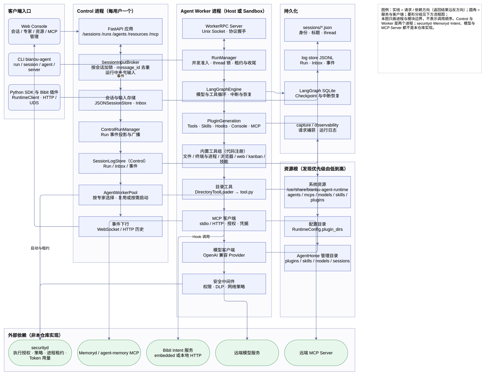
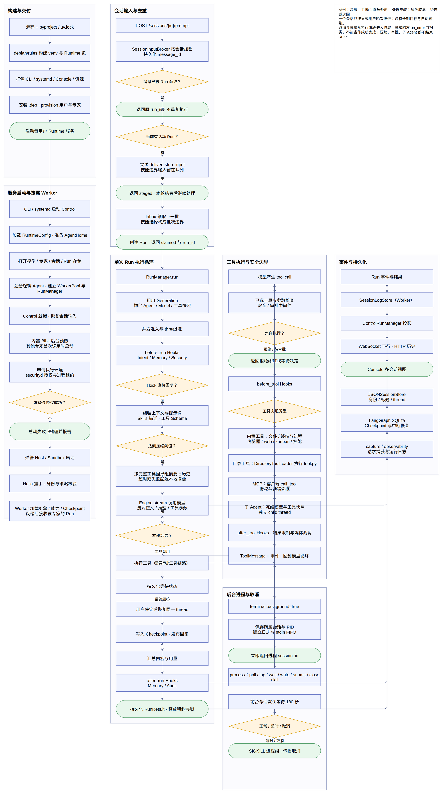

# 参考图册

本目录集中存放文档引用的架构图，源图（`.drawio`）与导出件（`.png`/`.svg`）同目录维护。

| 图 | 对应文档 | 内容 |
| --- | --- | --- |
| [01-architecture](01-architecture.png) · [svg](01-architecture.svg) · [drawio](runtime-repository.drawio) | 本图册 | 仓库整体架构：客户端入口 → Control → Worker → 外部依赖，持久化为独立列 |
| [02-flow](02-flow.png) · [svg](02-flow.svg) · [drawio](runtime-repository.drawio) | 本图册 | 仓库整体流程：构建 → 启动 → 请求 → Run → 工具 → 事件 |
| [01-overview](01-overview.png) · [svg](01-overview.svg) · [drawio](01-overview.drawio) | [概要设计](../overview-guide.md) §3.1 / §3.2 | 分层与边界：客户端入口 → Control → Worker → 外部依赖 |
| [02-run-flow](02-run-flow.png) · [svg](02-run-flow.svg) · [drawio](02-run-flow.drawio) | [概要设计](../overview-guide.md) §6.2 / §6.3 | 一次 Run 的执行流程、8 个 Hook 点、工具与审批分支、循环与异常路径 |
| [03-deployment](03-deployment.png) · [svg](03-deployment.svg) · [drawio](03-deployment.drawio) | [概要设计](../overview-guide.md) §3.2 / §6.1 | systemd 单元、运行用户、Control 与 Worker 池、沙箱边界、数据目录、外部依赖 |
| [04-events](04-events.png) · [svg](04-events.svg) · [drawio](04-events.drawio) | [概要设计](../overview-guide.md) §5.4 / §7 | 事件日志 → 历史回放与实时 mux → 客户端事件窗口 → Chat / Trajectory 投影 |

仓库级总图是一张整体架构图加一张整体流程图，细节写在节点文字里，源码依据按图列在下面；
图中的外部服务框表示依赖边界，不是本仓库的实现。两张仓库级图都在 `runtime-repository.drawio`
里，是同一个文件的两页。

代码基线：`8f81c5e5d84ac0ebefea82f1fc7f501020d9acb8`（Runtime 0.1.69，2026-09-16 整理），
覆盖 1108 个跟踪文件。

## 整体架构图

实线表示主要请求/依赖方向，返回结果沿反方向传递。Control 与 Worker 是两个进程边界；securityd、Memoryd、Intent、模型与 MCP Server 都不在本仓库实现。资源发现顺序为系统资源 → 配置目录 → AgentHome 管理目录。

图内分层：

- 客户端入口：Web Console、CLI、Python SDK 与 Bibit 插件，统一走 Control 的 HTTP/UDS 接口。
- Control 进程：FastAPI 接口、SessionInputBroker 去重与运行中补充、会话与输入存储、ControlRunManager、AgentWorkerPool、事件下行。
- Worker 进程：WorkerRPC、RunManager、LangGraphEngine、PluginGeneration 与内置/目录工具、MCP 客户端、模型客户端、安全中间件；Host 与 Sandbox 是同一个进程边界的不同执行环境。
- 持久化：会话 JSON、log store JSONL、LangGraph Checkpoint、capture/observability 各管一类数据，不能互相替代。
- 资源根：系统资源、配置目录、AgentHome 管理目录按优先级发现 plugins/skills/models/mcps/agents。
- 外部依赖：securityd、Memoryd/agent-memory、Bibit Intent、远端模型与远端 MCP Server。

### 源码依据

- [bianbu_agent/server/runtime.py](../../bianbu_agent/server/runtime.py)（主要定义从第 92 行起）
- [bianbu_agent/server/factory.py](../../bianbu_agent/server/factory.py)（主要定义从第 16 行起）
- [bianbu_agent/api/sessions.py](../../bianbu_agent/api/sessions.py)（主要定义从第 37 行起）
- [bianbu_agent/sessions/input.py](../../bianbu_agent/sessions/input.py)（主要定义从第 18 行起）
- [bianbu_agent/sessions/inbox.py](../../bianbu_agent/sessions/inbox.py)（主要定义从第 11 行起）
- [bianbu_agent/sessions/log_store.py](../../bianbu_agent/sessions/log_store.py)（主要定义从第 59 行起）
- [bianbu_agent/sessions/stores/json.py](../../bianbu_agent/sessions/stores/json.py)（主要定义从第 12 行起）
- [bianbu_agent/runs/manager.py](../../bianbu_agent/runs/manager.py)（主要定义从第 42 行起）
- [bianbu_agent/runs/control.py](../../bianbu_agent/runs/control.py)（主要定义从第 16 行起）
- [bianbu_agent/engines/langgraph/engine.py](../../bianbu_agent/engines/langgraph/engine.py)（主要定义从第 71 行起）
- [bianbu_agent/plugins/manager.py](../../bianbu_agent/plugins/manager.py)（主要定义从第 46 行起）
- [bianbu_agent/plugins/host.py](../../bianbu_agent/plugins/host.py)（主要定义从第 45 行起）
- [bianbu_agent/plugins/roots.py](../../bianbu_agent/plugins/roots.py)（主要定义从第 17 行起）
- [bianbu_agent/system_resources.py](../../bianbu_agent/system_resources.py)（主要定义从第 11 行起）
- [bianbu_agent/tools/builtins.py](../../bianbu_agent/tools/builtins.py)（主要定义从第 53 行起）
- [bianbu_agent/tools/loader.py](../../bianbu_agent/tools/loader.py)（主要定义从第 29 行起）
- [bianbu_agent/mcp/plugin.py](../../bianbu_agent/mcp/plugin.py)（主要定义从第 37 行起）
- [bianbu_agent/mcp/client.py](../../bianbu_agent/mcp/client.py)（主要定义从第 24 行起）
- [bianbu_agent/security/runtime_process/supervisor.py](../../bianbu_agent/security/runtime_process/supervisor.py)（主要定义从第 33 行起）
- [bianbu_agent/security/security_middleware.py](../../bianbu_agent/security/security_middleware.py)（主要定义从第 37 行起）
- [bianbu_agent/observability/log_store.py](../../bianbu_agent/observability/log_store.py)（主要定义从第 32 行起）
- [bianbu_agent/home.py](../../bianbu_agent/home.py)（主要定义从第 7 行起）

## 整体流程图

一个会话只按显式用户轮次推进，没有长期目标与自动续跑。取消与异常从执行阶段进入收尾，异常触发 on_error 并分类，不能当作成功完成。压缩、审批、子 Agent 都不结束 Run。

图内分区：

- 构建与交付：debian/rules 构建与打包，安装后 provision 用户与专家，启动每用户 Runtime 服务。
- 服务启动与按需 Worker：Control 先就绪，内置 Bibit 预热，其他专家首次调用时经 securityd 授权与租约后启动受管 Worker。
- 会话输入与去重：message_id 去重、活动 Run 的运行中补充、Inbox 批次与技能边界。
- 单次 Run 执行循环：租用 Generation 快照、before_run Hooks、上下文压缩、模型流式输出、工具/审批/最终回答三条分支、after_run Hooks 与 RunResult 落库。
- 工具执行与安全边界：安全与审批检查、before_tool/after_tool Hooks、内置工具/目录工具/MCP/子 Agent 四类实现、结果裁剪后回到模型循环。
- 后台进程与取消：后台进程有独立的 session_id 与生命周期，前台默认等待 180 秒，超时或取消走 SIGKILL 与取消传播。
- 事件与持久化：Run 事件经 SessionLogStore 投影到 Control，再下行到 Console；会话身份、Checkpoint 与运行日志分别归属各自存储。

### 源码依据

- [bianbu_agent/cli/main.py](../../bianbu_agent/cli/main.py)（主要定义从第 15 行起）
- [bianbu_agent/server/app.py](../../bianbu_agent/server/app.py)（主要定义从第 32 行起）
- [bianbu_agent/server/runtime.py](../../bianbu_agent/server/runtime.py)（主要定义从第 92 行起）
- [bianbu_agent/security/runtime_process/supervisor.py](../../bianbu_agent/security/runtime_process/supervisor.py)（主要定义从第 33 行起）
- [bianbu_agent/api/sessions.py](../../bianbu_agent/api/sessions.py)（主要定义从第 37 行起）
- [bianbu_agent/sessions/input.py](../../bianbu_agent/sessions/input.py)（主要定义从第 18 行起）
- [bianbu_agent/sessions/inbox.py](../../bianbu_agent/sessions/inbox.py)（主要定义从第 11 行起）
- [bianbu_agent/runs/manager.py](../../bianbu_agent/runs/manager.py)（主要定义从第 42 行起）
- [bianbu_agent/runs/control.py](../../bianbu_agent/runs/control.py)（主要定义从第 16 行起）
- [bianbu_agent/engines/langgraph/engine.py](../../bianbu_agent/engines/langgraph/engine.py)（主要定义从第 71 行起）
- [bianbu_agent/context/compression.py](../../bianbu_agent/context/compression.py)（主要定义从第 23 行起）
- [bianbu_agent/context/middleware.py](../../bianbu_agent/context/middleware.py)（主要定义从第 34 行起）
- [bianbu_agent/tools/runtime.py](../../bianbu_agent/tools/runtime.py)（主要定义从第 32 行起）
- [bianbu_agent/tools/builtins.py](../../bianbu_agent/tools/builtins.py)（主要定义从第 53 行起）
- [bianbu_agent/tools/processes/terminal.py](../../bianbu_agent/tools/processes/terminal.py)（主要定义从第 10 行起）
- [bianbu_agent/tools/processes/process.py](../../bianbu_agent/tools/processes/process.py)（主要定义从第 15 行起）
- [bianbu_agent/mcp/client.py](../../bianbu_agent/mcp/client.py)（主要定义从第 24 行起）
- [resources/plugins/bianbu.memory/scripts/before_run.py](../../resources/plugins/bianbu.memory/scripts/before_run.py)（主要定义从第 22 行起）
- [resources/plugins/bianbu.audit/scripts/after_run.py](../../resources/plugins/bianbu.audit/scripts/after_run.py)（主要定义从第 13 行起）
- [bianbu_agent/sessions/log_store.py](../../bianbu_agent/sessions/log_store.py)（主要定义从第 59 行起）
- [debian/rules](../../debian/rules)（主要定义从第 1 行起）
- [scripts/provision-system-agent.py](../../scripts/provision-system-agent.py)（主要定义从第 14 行起）

## 生成与验证

Hook 入口现为插件 `hooks/<id>/hook.json` 和 `scripts/` 外部程序（命令 Hook 协议）。

改图请改 `.drawio` 源图再导出，不要只改导出图片。全套图共用一套配色约定：
浅蓝方框 = 本仓库实现的模块，绿色圆角 = 外部依赖或 Hook 点，黄色菱形 = 分支判断，
实线 = 请求 / 依赖方向。校验包括 draw.io XML 解析、PNG 可解码和 PNG/SVG 与图页一一对应。

后续更新请以源码为准，同时维护每张图的 `.drawio`、`.png`、`.svg` 三件套；不要把历史设计
说明当作当前实现的唯一依据。
